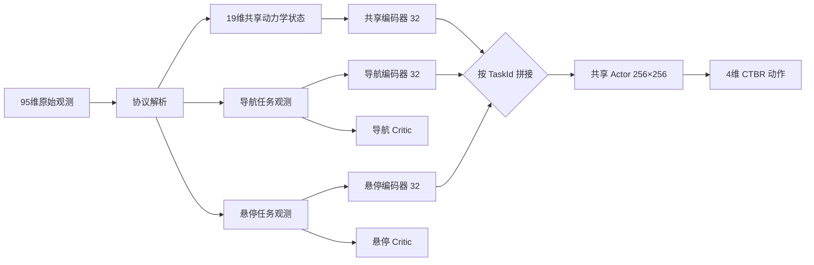
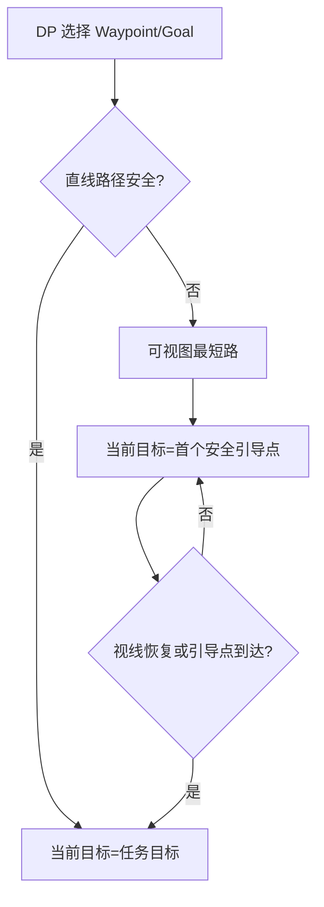

# RL-UAV：多任务 PPO 四旋翼自主避障导航

> **English abstract.** A portfolio-oriented, reproducible implementation of
> multi-task PPO for Crazyflie-style CTBR control. It combines a shared
> dynamics encoder, navigation/hover-specific encoders, independent critics,
> obstacle-aware waypoint ordering, online safety-guide switching, and staged
> curriculum learning. Isaac Sim and the competition SDK are optional external
> integrations; the planner, model smoke test, and unit tests run on CPU.

**2026 腾讯开悟人工智能全球公开赛｜基于强化学习的无人机自主避障导航系统**  
**2026.03–2026.06｜副队长、核心算法负责人**

> 赛事名次、95.54 / 86.22 / 96% 以及“约 50% 环境交互步数”等结果，当前均标记为
> **证据待导入**。仓库不会根据截图反推或伪造训练曲线；只有原始日志通过聚合校验后，
> 才会把数字标为“已复现”。

## 五分钟看懂项目

任务使用 Crazyflie 2.1 参数对齐的四旋翼和 PID-rate（CTBR）控制，从起点穿越随机生成、
单局内静止的落地圆柱障碍，尽可能访问 Waypoint，抵达终点后稳定悬停。这里的“动态避障”
指飞行过程中在线检测路径、重规划并在任务点与安全引导点之间切换，不表示障碍物会移动。

核心工程贡献：

1. 把导航和悬停视为共享动力学、不同观测与奖励的两个任务；共享 Actor，同时使用独立
   Critic 隔离价值尺度。
2. 把 Waypoint、终点和几何规划产生的安全点统一为 `TargetContext`，策略和奖励消费同一份
   快照，消除“策略追 A、奖励按 B 计算”的时序问题。
3. 用障碍感知的位掩码 DP 选择 Waypoint 顺序，再用膨胀圆可视图生成实时安全引导点。
4. 用可恢复、带门槛的课程状态机完成无障碍预训练、逐步增难和困难场景微调。





## Quick Start（无需 Isaac Sim）

推荐 Python 3.10 或 3.11：

```bash
python -m venv .venv
.venv/Scripts/activate
python -m pip install -e ".[dev]"
pytest -q
rl-uav-demo --output outputs/demo.gif
rl-uav-benchmark synthetic --output outputs/synthetic
```

演示中的轨迹是几何规划/运动学可视化，模型输出是未训练网络的接口冒烟测试；二者都不冒充
Isaac Sim 动力学或训练结果。

## 训练与评测协议

课程配置位于 `configs/curriculum.toml`。每阶段达到最小交互步数且连续两次 50 局固定评测
达标才晋级；超过最大步数则停止并保留失败状态。正式 benchmark 默认使用五个训练种子，
每 1M transitions 评测一次。

“达到 baseline 相当性能”要求连续三次评测同时满足：总分达到 FlatPPO 收敛均值的 95%，
成功率和 Waypoint 得分落后不超过 2 个百分点，碰撞率高出不超过 1 个百分点，悬停误差
不超过 baseline 的 1.05 倍。报告首次达标步数之比和 95% bootstrap CI。

| 实验 | 状态 | 说明 |
| --- | --- | --- |
| MultiTaskPPO × 5 seeds | 待导入 | 需要原始 JSONL/checkpoint |
| FlatPPO × 5 seeds | 待导入 | 主样本效率 baseline |
| SeparatePPO × 5 seeds | 待导入 | 专门化策略上界 |
| 官方 50 局 | 待导入 | 障碍 2–8、Waypoint 3–8 |
| 极限 50 局 | 待导入 | 8 障碍、0.45m、8 Waypoints |

## 平台集成

公开核心包不依赖 KaiwuDRL。`agent_ppo.agent.Agent` 保留比赛需要的入口，并在真正实例化时
才导入 KaiwuDRL；训练环境、`arena_proto`、OmniDrones 任务和平台工具需按赛事授权单独安装。
缺少外部依赖时，核心包和 CPU 测试仍可正常导入。

## 目录

```text
src/rl_uav/       核心类型、观测、规划、模型、PPO、奖励、课程与评测
agent_ppo/        KaiwuDRL 薄适配层（不包含平台源码）
baselines/        FlatPPO / SeparatePPO 说明与配置
configs/          课程和 benchmark 的可追溯 TOML
tests/            CPU 单元测试与可选平台契约测试
docs/             架构、复现和结果证据规范
```

## 限制与归因

- 当前仓库不含训练 checkpoint、可验证原始日志或官方评测 JSON，因此不发布具体性能结论。
- 当前轻量演示不是四旋翼动力学模拟器；完整训练必须在 Isaac Sim/OmniDrones 环境完成。
- 多任务网络结构明确借鉴 Xing 等人的工作，并针对导航/悬停阶段做工程化适配；Swift 论文仅
  作为学习型四旋翼控制背景。详见 [THIRD_PARTY.md](THIRD_PARTY.md)。
- 腾讯平台源码和文档因授权状态不明未进入公开树；本仓库未添加全局开源许可证。

## 代码修改记录

所有时间均为 Asia/Shanghai（CST, UTC+8）。每个代码修改批次必须在同一批次更新本表。

| 时间 | 修改内容 | 涉及模块 | 验证 |
| --- | --- | --- | --- |
| 2026-10-11 15:36:22 CST | 增加无 Isaac 的规划动画/模型冒烟演示，以及延迟加载的 KaiwuDRL Agent、workflow、配置和本地入口 | `demo`、`agent_ppo`、`conf`、`train_test.py` | 平台依赖保持外置；公开核心不导入 KaiwuDRL |
| 2026-10-11 15:33:22 CST | 实现可恢复课程状态机、50局 JSONL 证据 schema、五种子聚合、性能等价判定、bootstrap CI 与合成数据发布门禁 | `curriculum`、`evaluation`、`docs` | TOML/JSONL 数据流人工核对；合成报告明确标记不可作为真实证据 |
| 2026-10-11 15:31:31 CST | 实现论文对齐的共享编码/任务编码/双 Critic 网络、任务边界 GAE、均衡 PPO、Flat/Separate baseline 与 v2 checkpoint | `models`、`algorithms`、`checkpoint`、`baselines` | 统一模型 API 与 checkpoint schema 人工核对；待安装 PyTorch 后执行测试 |
| 2026-10-11 15:28:19 CST | 实现原始观测解析、统一目标数据流、障碍可视图、Waypoint 顺序优化及双任务奖励 | `observations`、`planning`、`rewards` | 接口维度与 95→19/31/5 设计人工核对；待自动化测试 |
| 2026-10-11 15:25:43 CST | 建立公开仓库骨架、依赖边界、证据声明与面试展示 README | 根目录、配置与文档元数据 | 原始 79 文件/12,710,042 字节备份已校验；Git 已初始化 |

